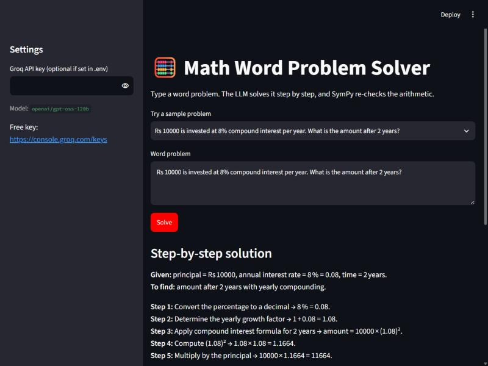
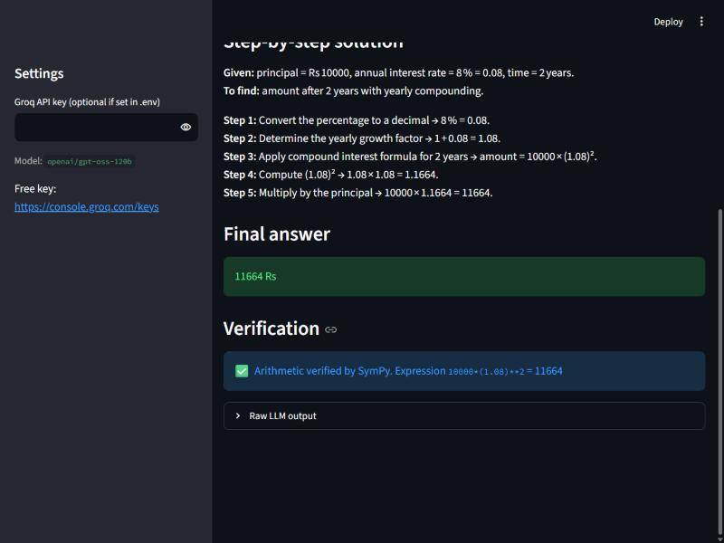

# 🧮 Math Word Problem Solver (LLM Mini Project)

**Problem statement:** Students struggle with word problems. This app solves a math word problem step by step, explains each step in simple words, and verifies the arithmetic with Python (SymPy).

## How it works
1. Student types a word problem (or picks a sample) in the Streamlit UI.
2. A prompt (system rules + one worked example = few-shot) asks the LLM to "think step by step" and end with two fixed lines:
   `EXPRESSION: <pure arithmetic>` and `FINAL ANSWER: <number> <unit>`.
3. The LLM (GPT-OSS 120B via the free Groq API) returns the solution.
4. The app parses the output, re-computes `EXPRESSION` with **SymPy** (only digits/operators allowed — no unsafe `eval`) and compares it with the final answer → ✅ verified / ⚠️ mismatch.

## Tech stack
Python · Streamlit · Groq API (`openai/gpt-oss-120b`) · SymPy · python-dotenv

## How to run
```bash
pip install -r requirements.txt
copy .env.example .env      # then put your free key from https://console.groq.com/keys
streamlit run app.py
```
(You can also paste the key in the app sidebar instead of using `.env`.)

## Files
| File | Purpose |
|---|---|
| `app.py` | Streamlit UI |
| `solver.py` | Prompt, LLM call, output parsing, SymPy verification |
| `requirements.txt` | Dependencies |
| `.env.example` | Template for the API key (real `.env` is git-ignored) |

## Screenshots


