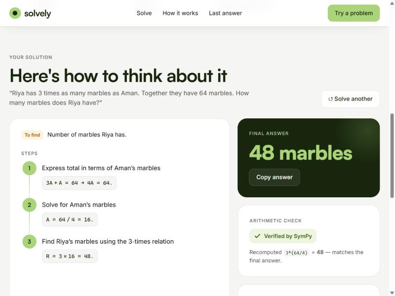
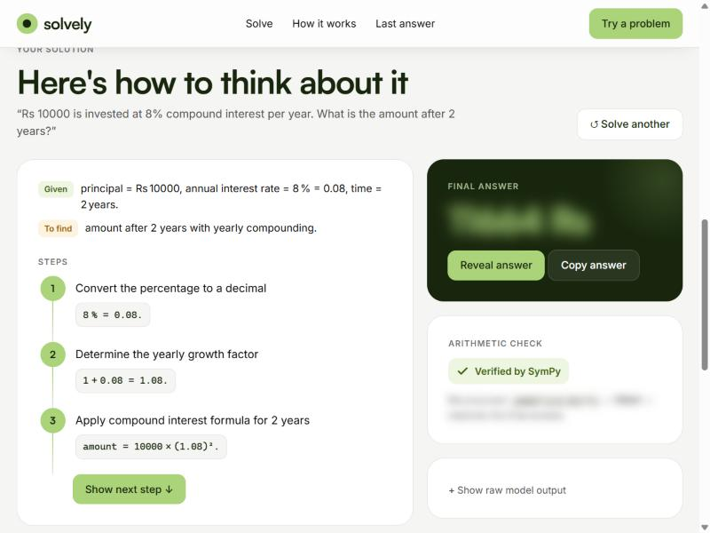
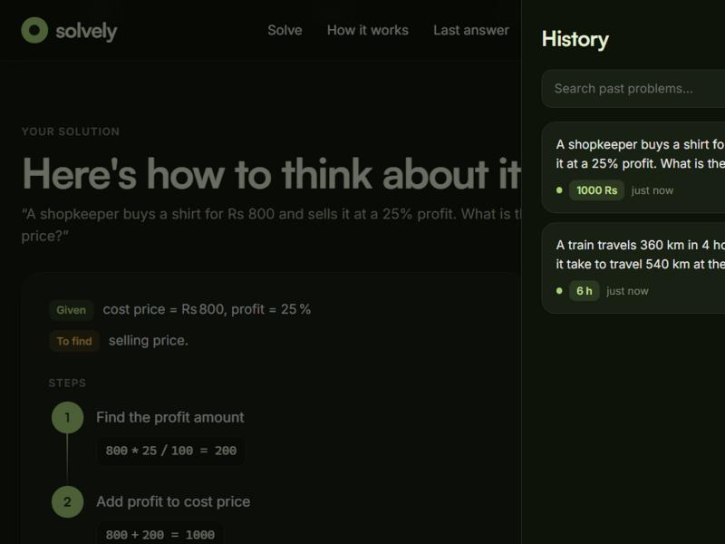

# 🧮 Solvely — Math Word Problem Solver (LLM Mini Project)

**Problem statement:** Students struggle with word problems. This app solves a math word problem step by step, explains each step in simple words, and verifies the arithmetic with Python (SymPy).

## How it works
1. Student types a word problem (or picks a topic chip) in the web UI.
2. A prompt (system rules + one worked example = few-shot) asks the LLM to "think step by step" and end with two fixed lines:
   `EXPRESSION: <pure arithmetic>` and `FINAL ANSWER: <number> <unit>`.
3. The LLM (GPT-OSS 120B via the free Groq API) returns the solution.
4. The app parses the output, re-computes `EXPRESSION` with **SymPy** (only digits/operators allowed — no unsafe `eval`) and compares it with the final answer → ✅ verified / ⚠️ mismatch.
5. The UI shows *Given / To find*, then an animated step timeline. **Learn mode** reveals one step at a time and blurs the answer until the student has tried each step.
6. **Dark mode** (follows the system setting, toggle with the moon icon or `D`) and **Solve history** (saved in the browser, searchable, reopen any past solution instantly without another API call; open with the clock icon or `H`).

## Tech stack
Python · FastAPI · HTML/CSS/JS (custom UI) · Groq API (`openai/gpt-oss-120b`) · SymPy · python-dotenv

## How to run
```bash
pip install -r requirements.txt
copy .env.example .env      # then put your free key from https://console.groq.com/keys
python app.py              # opens http://localhost:8000
```

## Files
| File | Purpose |
|---|---|
| `app.py` | FastAPI server (`/api/solve`) |
| `static/index.html` | Web UI: hero, topic chips, step timeline, Learn mode, verification card |
| `solver.py` | Prompt, LLM call, output parsing, SymPy verification |
| `requirements.txt` | Dependencies |
| `.env.example` | Template for the API key (real `.env` is git-ignored) |

## Screenshots





